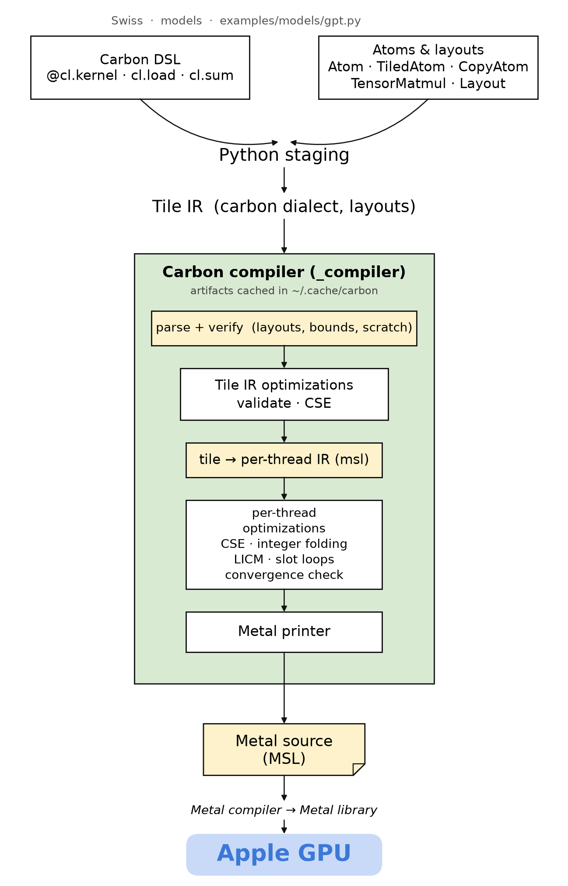

# Compiler

Carbon's IR follows a thread-based design, with first-class control of Metal threads,
down to the matrix atoms (8x8 blocks per SIMD group).

## Source map

| Location | Contents |
| --- | --- |
| [`python/carbon/language.py`](../python/carbon/language.py) | Public types and operations (`cl.*`) |
| [`python/carbon/compiler/`](../python/carbon/compiler/) | Staging, Views, atoms, artifacts, `check_writes` |
| [`compiler/tile/`](../compiler/tile/) | Tile IR: operations (`dialect.td`), verifiers, the layout algebra (`layout.cpp`), scratch and memory analysis; parse, verify and clean up a module (`module.cpp`) |
| [`compiler/thread/`](../compiler/thread/) | Per-thread IR (`dialect.td`), lowering, integer facts, optimization, MSL printing |
| [`compiler/bindings/`](../compiler/bindings/) | The `_compiler` Python module: layouts (`layouts.cpp`), staging (`builder.cpp`), compilation (`module.cpp`) |
| [`runtime/`](../runtime/) | Buffers, pipeline compilation, dispatch, completion (`_metal`) |
| [`python/carbon/kernels/`](../python/carbon/kernels/) | Kernels written in Carbon, general across models (see [what belongs in Carbon](../README.md#what-belongs-in-carbon)): matrix products and the launcher and search that choose them (`gemm/`), attention (`attention/`), sampling and row indexing (`ops/`) |
| [`examples/`](../examples/) | Small kernels that each show one feature |




Carbon compiles one kernel at a time, for Metal only:

```text
Python kernel  --staging-->  tile IR (carbon dialect)
               --verify, layout propagation, CSE-->  per-thread IR (msl dialect)
               --facts, folding, vector accesses, hoisting-->  MSL text
               --Apple's Metal compiler-->  Metal library and pipeline
```

Staging runs the Python function once and builds tile operations, `arith` and
`scf` directly in the compiler's IR, through the `_compiler` module. Layouts are
the compiler's own objects, and each operation infers its result type in C++ (a
reshape, stack or transpose from the layout algebra), so Python never derives one;
only operations whose result type is their parameter, such as a cast, a layout
conversion or a reduction, are given it.
The tile IR gives every tile a layout, so the verifier can check ownership,
scratch synchronization and uniform control flow. The Metal back end then writes
out what one thread does, with every access checked, and works out what the integers
are: each value's range and power-of-two divisor, from lanes, SIMD groups, loop
bounds, `max_grid`, static Views and binding sizes (`compiler/thread/analysis.cpp`).
Checks those facts decide are folded, indices with the same linear form are merged,
and neighbouring accesses become vector accesses (`compiler/thread/optimize.cpp`).
Float math is never folded. A printer turns each per-thread operation into one Metal
statement. Matrix units take and give ordinary tiles, in register layouts that
Python measures on the device: `carbon.mma` prints as `simdgroup_multiply_accumulate`
or a per-SIMD-group `matmul2d`, and `carbon.tensor_matmul` as a threadgroup-wide
MetalPerformancePrimitives `matmul2d`.
Register-only `mma` operations have no memory effects, so existing common-subexpression
and dead-code elimination can remove repeated products and unused results. They remain
non-speculatable and retain their collective control-flow requirements.

There is no lazy-array graph and no hidden device memory. Carbon does not emit
Apple's internal GPU IR; Apple's compiler does the rest.

Tile cleanup cancels layout round trips through elementwise computations whose
results have no other consumers. It changes ownership without changing arithmetic
order. Scratch-backed conversions remain typed operations through this step. A
private round trip can keep its computation in registers and release its workspace;
each removed conversion retains a barrier so unrelated scratch stays synchronized.
Observable workspaces, replicated output layouts and group-dependent computations
are preserved. Remaining conversions expand to stores, loads and barriers in native
lowering, using the same expansion for scratch validation.

`kernel.stage(...).ir` shows the typed operations after tile optimization;
`artifact.ir` shows scratch conversions materialized for memory planning, and
`artifact.thread_ir` shows the individual thread operations. Allocation lifetime
positions refer to the materialized tile IR.
Threadgroup memory limits apply to this physical plan, after fusion and footprint
planning, rather than to the logical size of a scratch declaration.

Scratch used only by native scalar reductions and `item` is allocated for the
partial values actually exchanged, rather than the full logical tile. Optional
workspaces take no space when the collective analysis proves that communication
stays within a SIMD group. Other uses,
including explicit loads, stores and views, retain the declared extent. The same
lifetime and barrier analysis places both kinds of region. `scratch_layout` reports
the physical byte count alongside the logical storage shape; a smaller allocation
does not by itself imply higher throughput.

The thread optimizer hoists invariant loads from read-only device bindings. For
runtime loop bounds, a guard keeps those reads inside the loop's nonempty case.
It leaves mutable bindings, scratch reads and conditionally executed loads alone.
For loops containing barriers, hoisting also runs before vectorization so tail
branches do not trap invariant loads behind synchronization. Other loops retain
their existing optimization order, as do loops known to execute at most once.

Contiguous byte accesses can use up to 16 bytes per instruction. The printer packs
them into `uint` vectors and unpacks bits without numerical conversion; alignment,
alias and tail proofs stay in the existing vectorizer. Wider-element accesses keep
their four-element limit. Widening 16-bit accesses did not improve the measured M5
transfer probes consistently, so it is not enabled.


